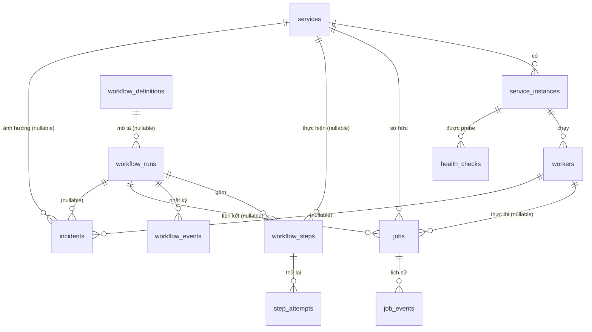

# Cấu trúc database

PostgreSQL 16, schema `public`, quản lý bằng Alembic (revision hiện tại: **0005**). Dữ liệu trích từ database đang chạy,
không viết theo trí nhớ. Mọi khóa chính là `uuid`; mọi thời điểm là `timestamptz` (UTC).

Nguyên tắc: đây là **dữ liệu quản lý và lifecycle** cần truy vấn. Log, trace và metric nằm ở backend chuyên dụng và
chỉ được dẫn link (xem ADR-0002, ADR-0012).

## Sơ đồ quan hệ

## Nhóm 1. Registry

### `services`
Một service logic, định danh bởi `(name, environment)`.

| Cột | Kiểu | Ghi chú |
|---|---|---|
| id | uuid PK | |
| name | varchar(200) NOT NULL | |
| version | varchar(100) | phiên bản mới nhất service tự khai |
| environment | varchar(100) NOT NULL | `production`, `development`, `unknown`... |
| metadata | jsonb NOT NULL | |
| created_at, updated_at | timestamptz NOT NULL | |

Ràng buộc: **UNIQUE (name, environment)** (`uq_services_name_env`). Cùng tên khác environment là hai service khác nhau.

### `service_instances`
Một tiến trình/instance của service.

| Cột | Kiểu | Ghi chú |
|---|---|---|
| id | uuid PK | |
| service_id | uuid FK → services NOT NULL | |
| instance_id | varchar(200) NOT NULL | do service tự đặt; **phải cố định** (ADR-0004) |
| hostname | varchar(200) | |
| status | varchar(20) NOT NULL | `HEALTHY` / `UNHEALTHY` / `STOPPED` |
| last_heartbeat_at | timestamptz NOT NULL | |
| registered_at | timestamptz NOT NULL | |
| metadata | jsonb NOT NULL | chứa `health_url` nếu bật probe (ADR-0010) |

Ràng buộc: **UNIQUE (service_id, instance_id)**. Index: `status`, `last_heartbeat_at`.

### `workers`
Worker thuộc một instance.

| Cột | Kiểu | Ghi chú |
|---|---|---|
| id | uuid PK | |
| service_instance_id | uuid FK → service_instances NOT NULL | |
| worker_name | varchar(200) NOT NULL | |
| worker_type | varchar(100) NOT NULL | mặc định `default` |
| status | varchar(20) NOT NULL | `REGISTERED` `STARTING` `IDLE` `BUSY` `DRAINING` `STOPPED` `UNHEALTHY` |
| current_job_key | varchar(200) | job đang chạy (ID do service đặt) |
| capacity | integer NOT NULL | mặc định 1 |
| last_heartbeat_at, registered_at | timestamptz NOT NULL | |
| metadata | jsonb NOT NULL | |

Ràng buộc: **UNIQUE (service_instance_id, worker_name)**. Index: `status`, `last_heartbeat_at`.

### `health_checks`
Một lần platform chủ động probe `health_url` (ADR-0010).

| Cột | Kiểu | Ghi chú |
|---|---|---|
| id | uuid PK | |
| service_instance_id | uuid FK → service_instances NOT NULL | |
| checked_at | timestamptz NOT NULL | |
| ok | boolean NOT NULL | |
| status_code | integer | null khi không kết nối được |
| latency_ms | double precision | |
| error | varchar(300) | |
| system | jsonb NOT NULL | số liệu hạ tầng lọc theo danh sách cho phép |

Index: `(service_instance_id, checked_at)`. Giữ 14 ngày (`OBSKIT_PLATFORM_HEALTH_RETENTION_DAYS`).

## Nhóm 2. Workflow (nhật ký sự kiện bất biến + trạng thái dẫn xuất)

### `workflow_events` (nguồn sự thật, chỉ thêm, không sửa payload)
| Cột | Kiểu | Ghi chú |
|---|---|---|
| id | uuid PK | |
| event_id | varchar(200) **UNIQUE** NOT NULL | khóa idempotency do SDK sinh |
| workflow_run_id | uuid FK → workflow_runs NOT NULL | |
| workflow_step_id | uuid FK → workflow_steps | |
| attempt_id | uuid FK → step_attempts | |
| event_type | varchar(40) NOT NULL | xem mục Enum |
| event_version | integer NOT NULL | hiện chỉ hỗ trợ `1` |
| occurred_at | timestamptz NOT NULL | thời điểm xảy ra (do nguồn khai) |
| received_at | timestamptz NOT NULL | thời điểm platform nhận |
| source_service | varchar(200) NOT NULL | |
| payload | jsonb NOT NULL | nguyên văn sự kiện |
| disposition | varchar(20) NOT NULL | `APPLIED` / `STALE` / `QUARANTINED` |
| disposition_reason | varchar(500) | |

Chỉ `disposition*` được cập nhật sau khi chèn (khi replay). Index: `(workflow_run_id, occurred_at)`, `received_at`, `disposition`.

### `workflow_runs`
| Cột | Kiểu | Ghi chú |
|---|---|---|
| id | uuid PK | |
| run_key | varchar(200) **UNIQUE** NOT NULL | ID run do SDK sinh |
| workflow_id | varchar(200) NOT NULL | ID workflow nghiệp vụ |
| workflow_definition_id | uuid FK → workflow_definitions | |
| status | varchar(20) NOT NULL | `WorkflowStatus` |
| correlation_id, trace_id | varchar(200) | |
| started_at, finished_at | timestamptz | |
| duration_ms | bigint | tính khi có started và finished |
| input_metadata, output_metadata | jsonb NOT NULL | |
| error_details | jsonb | |
| last_event_at | timestamptz | |
| created_at | timestamptz NOT NULL | |

Index: `workflow_id`, `status`, `started_at`, `correlation_id`.

### `workflow_steps`
| Cột | Kiểu | Ghi chú |
|---|---|---|
| id | uuid PK | |
| workflow_run_id | uuid FK NOT NULL | |
| parent_step_id | uuid FK → workflow_steps | cây bước |
| step_key | varchar(200) NOT NULL | |
| step_name | varchar(200) NOT NULL | |
| service_id | uuid FK → services | service thực hiện bước |
| status | varchar(20) NOT NULL | `StepStatus` |
| latest_attempt_number | integer NOT NULL | |
| started_at, finished_at | timestamptz | |
| sequence_number | integer NOT NULL | thứ tự hiển thị |

Ràng buộc: **UNIQUE (workflow_run_id, step_key)**. Index: `status`.

### `step_attempts`
Lịch sử từng lần thử của một bước.

| Cột | Kiểu | Ghi chú |
|---|---|---|
| id | uuid PK | |
| workflow_step_id | uuid FK NOT NULL | |
| attempt_key | varchar(200) | |
| attempt_number | integer NOT NULL | |
| status | varchar(20) NOT NULL | `RUNNING` `COMPLETED` `FAILED` `CANCELLED` |
| worker_key | varchar(200) | tên worker do SDK báo, **không phải FK** |
| trace_id | varchar(200) | |
| started_at, finished_at | timestamptz | |
| error_details | jsonb | |

Ràng buộc: **UNIQUE (workflow_step_id, attempt_number)**.

### `workflow_definitions`
Định nghĩa workflow (tùy chọn). **UNIQUE (name, version)**. Cột: `id`, `name`, `version`, `description`, `definition jsonb`, `created_at`.

### `rejected_events`
Sự kiện không qua kiểm tra hợp lệ, giữ để điều tra. Cột: `id`, `received_at`, `raw jsonb` (nguyên văn), `error text`.

## Nhóm 3. Job và incident

### `jobs`
Trạng thái hiện tại của job.

| Cột | Kiểu | Ghi chú |
|---|---|---|
| id | uuid PK | |
| external_job_id | varchar(200) NOT NULL | ID do service đặt |
| service_id | uuid FK NOT NULL | |
| worker_id | uuid FK → workers | |
| workflow_run_id | uuid FK → workflow_runs | |
| workflow_run_key | varchar(200) | giữ key để nối khi run đến sau job |
| trace_id | varchar(200) | trace/log của job (từ migration 0005; trước đó nằm trong `metadata`) |
| status | varchar(20) NOT NULL | `QUEUED` `RUNNING` `COMPLETED` `FAILED` `CANCELLED` |
| created_at, started_at, finished_at | timestamptz | |
| metadata | jsonb NOT NULL | |
| error_details | jsonb | |

Ràng buộc: **UNIQUE (service_id, external_job_id)**. Index: `status`, `workflow_run_id`, `workflow_run_key`, `trace_id`.

### `job_events` (từ migration 0004)
Mỗi lần đổi trạng thái của job (ADR-0011).

| Cột | Kiểu | Ghi chú |
|---|---|---|
| id | uuid PK | |
| job_id | uuid FK → jobs NOT NULL | |
| event_type | varchar(30) NOT NULL | `JOB_QUEUED` `JOB_STARTED` `JOB_COMPLETED` `JOB_FAILED` `JOB_CANCELLED` |
| previous_status | varchar(20) | null cho sự kiện đầu hoặc sự kiện dựng lại |
| current_status | varchar(20) NOT NULL | |
| service_id | uuid FK NOT NULL | |
| worker_id | uuid FK → workers | |
| occurred_at | timestamptz NOT NULL | |
| detail | jsonb NOT NULL | `{"error": {...}}` khi FAILED; `{"backfilled": true}` cho dữ liệu dựng lại |

Index: `(job_id, occurred_at)`.

### `incidents`
| Cột | Kiểu | Ghi chú |
|---|---|---|
| id | uuid PK | |
| service_id, workflow_run_id, worker_id | uuid FK (đều nullable) | |
| severity | varchar(20) NOT NULL | `LOW` `MEDIUM` `HIGH` `CRITICAL` |
| title | varchar(300) NOT NULL | |
| description | text | |
| status | varchar(20) NOT NULL | `OPEN` / `RESOLVED` |
| dedupe_key | varchar(200) | một điều kiện chỉ có một incident OPEN |
| detected_at, resolved_at | timestamptz | |

Index: `status`, `dedupe_key`, `detected_at`. Các loại `dedupe_key`: `instance-stale:<id>`, `worker-stale:<id>`,
`instance-health-failing:<id>`, `workflow-failed:<run id>`.

## Quy tắc trạng thái

**Job:** `QUEUED → RUNNING → COMPLETED | FAILED | CANCELLED`. Trạng thái kết thúc là cuối cùng: cập nhật muộn
(ví dụ `RUNNING` sau `COMPLETED`) bị từ chối và **không ghi sự kiện**. Cập nhật lặp cùng trạng thái cũng không ghi sự kiện.

**Workflow run:** thứ hạng `CREATED(0) < QUEUED(1) < RUNNING(2) < {COMPLETED, FAILED, CANCELLED, TIMED_OUT}(3)`.
Chỉ tiến, không lùi. Sự kiện kết thúc mâu thuẫn với trạng thái kết thúc hiện tại → `QUARANTINED`; trùng → `STALE`.

**Step:** khóa thứ tự là `(attempt_number, thứ hạng trạng thái)` với `PENDING(0) < QUEUED(1) < RUNNING(2) < RETRYING(3) < kết thúc(4)`.
Attempt cao hơn thay thế attempt thấp đã thất bại. `STEP_FAILED` kèm `will_retry=true` đặt bước ở `RETRYING`.

**Service (tổng hợp từ instance còn "sống", tức chưa STOPPED):** không có instance → `NO_INSTANCES`; toàn bộ STOPPED → `STOPPED`;
tất cả HEALTHY → `HEALTHY`; một phần HEALTHY → `DEGRADED`; không cái nào HEALTHY → `UNHEALTHY`.

**Instance/worker:** quá `OBSKIT_PLATFORM_HEARTBEAT_TIMEOUT_S` (30 giây) không heartbeat → `UNHEALTHY` + mở incident.
Heartbeat kế tiếp đóng incident. `UNHEALTHY` quá 24 giờ → `STOPPED`. `STOPPED` quá 7 ngày → bị xóa (ADR-0009).

## Xóa dữ liệu và khóa ngoại

Khi retention xóa worker/instance: `jobs.worker_id`, `job_events.worker_id`, `incidents.worker_id` được đặt `NULL` (lịch sử
giữ nguyên); `health_checks` của instance bị xóa cùng instance. Job, sự kiện job, incident và workflow **không** bị retention xóa
(retention cho nhóm này chưa xây).

## Quy ước JSON

- `error` / `error_details`: `{"type": "...", "message": "..."}` (các khóa khác được giữ).
- `health_checks.system`: chỉ các khóa số trong danh sách cho phép: `cpu_percent`, `memory_percent`, `disk_percent`, `load_1m`,
  `cpu_count`, `memory_total_mb`, `memory_used_mb`, `disk_total_gb`, `disk_used_gb`, `process_cpu_percent`,
  `process_memory_mb`, `active_requests`, `queue_depth`.
- `service_instances.metadata.health_url`: URL `http(s)` để probe.
- `jobs.metadata.trace_id`: trace của job.

## Enum

| Enum | Giá trị |
|---|---|
| WorkflowStatus | CREATED, QUEUED, RUNNING, COMPLETED, FAILED, CANCELLED, TIMED_OUT |
| StepStatus | PENDING, QUEUED, RUNNING, COMPLETED, FAILED, RETRYING, SKIPPED, CANCELLED |
| AttemptStatus | RUNNING, COMPLETED, FAILED, CANCELLED |
| EventType | WORKFLOW_{CREATED,QUEUED,STARTED,COMPLETED,FAILED,CANCELLED,TIMED_OUT}, STEP_{QUEUED,STARTED,COMPLETED,FAILED,SKIPPED,CANCELLED} |
| Disposition | APPLIED, STALE, QUARANTINED |
| IngestOutcome | ACCEPTED, DUPLICATE, REJECTED |
| InstanceStatus | HEALTHY, UNHEALTHY, STOPPED |
| WorkerStatus | REGISTERED, STARTING, IDLE, BUSY, DRAINING, STOPPED, UNHEALTHY |
| JobStatus | QUEUED, RUNNING, COMPLETED, FAILED, CANCELLED |
| Severity | LOW, MEDIUM, HIGH, CRITICAL |
| IncidentStatus | OPEN, RESOLVED |

## Lịch sử migration

| Revision | Nội dung |
|---|---|
| 0001 | Schema ban đầu: services, workflow_definitions, workflow_runs, workflow_steps, step_attempts, workflow_events, rejected_events |
| 0002 | service_instances, workers, jobs, incidents |
| 0003 | `health_checks` |
| 0004 | `job_events` + dựng lại lịch sử cho job đã có (chỉ trên PostgreSQL) |
| 0005 | `jobs.trace_id` + index; chuyển `trace_id` từ `metadata` sang cột (chỉ trên PostgreSQL) |

Migration là bước **chủ động**, không tự chạy khi khởi động ứng dụng; trong `docker-compose.yml` nó chạy bằng service `migrate`
trước `platform`.
